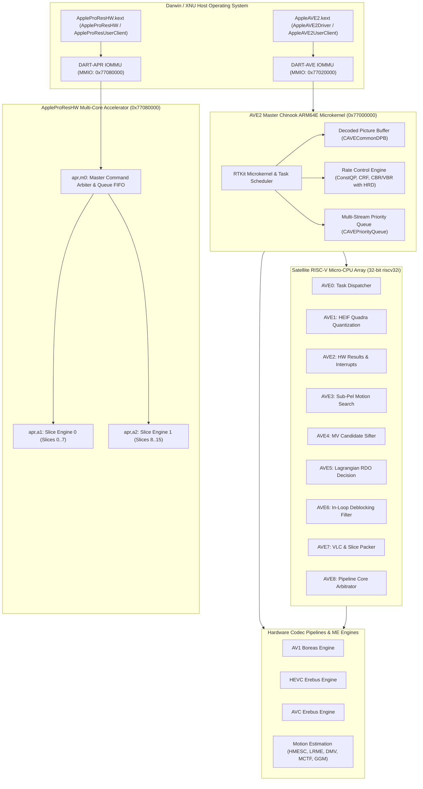

# Apple Video Encoder 2 (AVE2) & AppleProResHW Hardware Codec Accelerators: Clean-Room Architectural Specification

[](#clean-room-statement)
[-orange.svg)](#hardware-platform--target-os)
[-purple.svg)](#hardware-platform--target-os)
[](#verification-suite)
[](LICENSE)

An independent, clean-room architectural specification, register geometry model, hardware command queue ABI, and multi-codec execution framework for Apple's **Apple Video Encoder 2 (AVE2)** and **AppleProResHW** coprocessors on modern Apple Silicon (A19 Pro / `t8150` / `iPhone18,3` / `v57ap` / iOS 27.2 `24B119`).

---

## Architecture Overview

Video encoding on A19 Pro (`t8150`) is partitioned across two coordinated hardware accelerator engines:

1. **AppleProResHW (`apr,m0`, `apr,a1`, `apr,a2`)**: Dedicated multi-core accelerator for real-time 8K60 encoding of Apple ProRes 422 (Proxy, LT, Standard, HQ), Apple ProRes 4444 / 4444 XQ (including alpha channels), and uncompressed Bayer Apple ProRes RAW / ProRes RAW HQ.
2. **Apple Video Encoder 2 (AVE2)**: Heterogeneous media subsystem controlled by an ARM64e Chinook core running RTKit, 9 satellite 32-bit RISC-V micro-CPUs (`AVE0` through `AVE8`), and dedicated hardware Motion Estimation coprocessors:
   - **`HMESC`**: Hierarchical Motion Estimation and Spatial Complexity evaluation
   - **`LRME`**: Low-Resolution Motion Estimation on 16:1 downsampled luma pyramids
   - **`DMV`**: Dense Motion Vector quarter-pel displacement calculator
   - **`MCTF`**: Motion-Compensated Temporal Filtering multi-frame denoiser
   - **`GGM`**: Global and Group Motion affine trajectory analyzer
   - **`OF`**: High-density Optical Flow coprocessor



---

## Hardware Platform & Target OS

- **SoC**: Apple Silicon A19 Pro (`t8150`)
- **Device Model**: iPhone 18,3 (`v57ap`)
- **Target OS**: iOS 27.2 (Darwin 24.2.0, Build `24B119`)
- **MMIO Apertures**:
  - `AppleAVE2`: `0x77000000` (Core) / `0x77020000` (`dart-ave`, 128 KB)
  - `AppleProResHW`: `0x77080000` (`apr,m0`, `apr,a1`, `apr,a2`, 256 KB)
- **Firmware Containers**: Image4 (`.im4p`) format (`AppleAVE2FW_H18.im4p` and `AVE0`..`AVE8`)

---

## Key Invariants & Extraction Gates

| Invariant Parameter | Value | Architectural Significance |
| :--- | :---: | :--- |
| **Mach-O Magic** | `0xfeedfacf` | 64-bit Mach-O Header (`MH_MAGIC_64`) |
| **CPU Type / Subtype** | `0x0100000c` / `0x80000002` | ARM64E with Pointer Authentication (PAC00) |
| **Filetype** | `0x00000005` | `MH_PRELOAD` bare-metal coprocessor firmware |
| **DART-AVE MMIO Base** | `0x77020000` | Apple DART IOMMU translation unit (128 KB aperture) |
| **DART-APR MMIO Base** | `0x77080000` | Apple ProRes DART IOMMU unit (256 KB aperture) |
| **Satellite Cores Count** | `9` | 32-bit RISC-V (`riscv32i`) auxiliary micro-CPUs |
| **ProRes 422 HQ 8K Slices** | `16` | Horizontal slice bands split across `apr,a1` and `apr,a2` |
| **ProRes RAW CFA Planes** | `4` | $R$, $G_r$, $G_b$, $B$ planar Bayer ingestion |
| **ProRes RAW FrameHeader** | `128 Bytes` | Coded crop, CFA pattern, analog gains, $3\times3$ color matrix |
| **ME Engines** | `LRME`, `MCTF`, `DMV`, `GGM`, `HMESC` | Dedicated hardware motion estimation units |
| **Command Ring Opcodes** | 16 Opcodes (`0x01` - `0x10`) | Asynchronous lock-free ring submission ABI |
| **XNU UserClient Methods** | 10 Selectors (`IO_Open` .. `IO_Reset`) | `AppleAVE2UserClient` dispatch interface |

---

## Repository Structure

```
├── README.md               # Repository documentation and architecture overview
├── LICENSE                 # MIT License
├── docs/
│   ├── MASTER_DOSSIER.md   # Comprehensive clean-room specification (>74 KB)
│   ├── 01A_WORKSPACE_BASELINE.md
│   ├── 01B_ARCHITECTURE_AND_TOPOLOGY.md
│   ├── 02_HARDWARE_REGISTER_GEOMETRY.md
│   ├── 03_COMMAND_QUEUE_AND_WIRE_FORMAT.md
│   ├── 04_KERNEL_BOUNDARY_CLIENT.md
│   └── 05_PRORES_AND_MOTION_ESTIMATION_HARDWARE.md (>42 KB)
├── specs/
│   ├── apple_prores_hw_register_geometry.json
│   ├── ave_command_queue_spec.json
│   ├── ave_firmware_container_spec.json
│   ├── ave_hardware_register_geometry.json
│   ├── ave_topology_spec.json
│   ├── codec_control_descriptors.json
│   ├── codec_pipeline_architecture.json
│   ├── cross_validation_matrix.json
│   ├── dma_descriptor_geometry.json
│   ├── motion_estimation_coprocessor_spec.json
│   ├── phase_1a_workspace_baseline.json
│   ├── prores_422_hq_pipeline_spec.json
│   ├── prores_raw_pipeline_spec.json
│   └── xnu_ave_boundary_spec.json
├── runtime/
│   ├── include/
│   │   ├── apple_prores_hw.h
│   │   └── ave2_motion_estimation.h
│   ├── ave_direct_submit.c         # AVE2 command submission client
│   └── prores_8k_encode_submit.c   # 8K ProRes 422 HQ & RAW submission client
└── tools/
    ├── verify_ave_constants.py     # AVE2 architecture verification test suite
    └── verify_prores_me_hardware.py # ProRes & ME coprocessor test suite
```

---

## Verification Suites

To execute the independent invariant verification suite for AVE2:

```bash
python3 tools/verify_ave_constants.py
```

To execute the verification suite for AppleProResHW and Motion Estimation:

```bash
python3 tools/verify_prores_me_hardware.py
```

To verify the standalone C runtime clients:

```bash
gcc -fsyntax-only -Wall -Wextra -Werror runtime/ave_direct_submit.c
gcc -fsyntax-only -Wall -Wextra -Werror runtime/prores_8k_encode_submit.c -Iruntime/include
```

---

## Clean-Room Statement

This research specification and reverse-engineered client were constructed using standard clean-room reverse engineering methodologies. All constants, register offsets, command descriptors, and structures were derived through empirical static and dynamic analysis of decrypted firmware binaries, kernel caches, and device trees from publicly distributed restore images. No proprietary source code, SDK private headers, or internal documentation was utilized.
