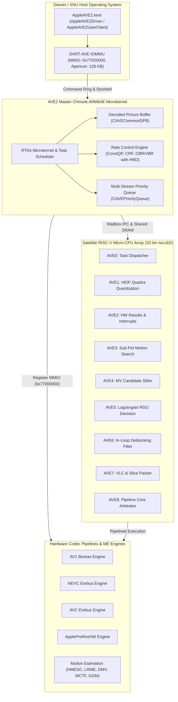

# Apple Video Encoder 2 (AVE2) Hardware Codec Accelerator: Clean-Room Architectural Specification

[](#clean-room-statement)
[-orange.svg)](#hardware-platform--target-os)
[-purple.svg)](#hardware-platform--target-os)
[](#verification-suite)
[](LICENSE)

An independent, clean-room architectural specification, register geometry model, hardware command queue ABI, and multi-codec execution framework for Apple's **Apple Video Encoder 2 (AVE2)** coprocessor on modern Apple Silicon (A19 Pro / `t8150` / `iPhone18,3` / `v57ap` / iOS 27.2 `24B119`).

---

## Architecture Overview

The Apple Video Encoder 2 (AVE2) coprocessor incorporates a heterogeneous multi-processor architecture operating across two tiers:

1. **Master Chinook ARM64e Core**: Executes an embedded RTKit preemptive microkernel managing virtual memory, task scheduling, picture management (`CAVECommonDPB`), rate control models, and slice syntax generation.
2. **Satellite RISC-V Micro-CPU Array**: 9 dedicated 32-bit `riscv32i` coprocessors (`AVE0` through `AVE8`) accelerating inner-loop tasks including task dispatch, HEIF Quadra Bayer variance quantization, hardware result collection, sub-pixel interpolation, motion candidate sifting, Lagrangian RDO skip decisions, in-loop deblocking filtering, VLC slice packing, and core arbitration.
3. **Dedicated Motion Estimation Hardware**: High-throughput silicon coprocessors (`HMESC`, `LRME`, `DMV`, `MCTF`, `GGM`, and optical flow).
4. **Multi-Codec Pipeline Acceleration**: Hardware support for AV1 Boreas (Profile 0 Main), HEVC Erebus (Main/Main10/Main 4:2:2 10), AVC Erebus, and Apple ProRes 422/4444.



---

## Hardware Platform & Target OS

- **SoC**: Apple Silicon A19 Pro (`t8150`)
- **Device Model**: iPhone 18,3 (`v57ap`)
- **Target OS**: iOS 27.2 (Darwin 24.2.0, Build `24B119`)
- **Firmware Container**: Image4 (`.im4p`) format
- **Main Firmware**: `Firmware/ave/AppleAVE2FW_H18.im4p` (`avef`, 2,687,560 B raw Mach-O 64-bit MH_PRELOAD ARM64e)
- **Satellite Microcodes**: `AppleAVE2FW_H18_AVE0.im4p` through `AppleAVE2FW_H18_AVE8.im4p` (`ave0` through `ave8`)

---

## Key Invariants

| Invariant Parameter | Value | Architectural Significance |
| :--- | :---: | :--- |
| **Mach-O Magic** | `0xfeedfacf` | 64-bit Mach-O Header (`MH_MAGIC_64`) |
| **CPU Type / Subtype** | `0x0100000c` / `0x80000002` | ARM64E with Pointer Authentication (PAC00) |
| **Filetype** | `0x00000005` | `MH_PRELOAD` bare-metal coprocessor firmware |
| **DART-AVE MMIO Base** | `0x77020000` | Apple DART IOMMU translation unit (128 KB aperture) |
| **AVE2 Core MMIO Base** | `0x77000000` | Hardware control registers and satellite core reset lines |
| **Satellite Cores Count** | `9` | 32-bit RISC-V (`riscv32i`) auxiliary micro-CPUs |
| **AV1 Boreas Symbol** | `_gc_sAVE_DevCap_DPMMap_AV1_Boreas` | First-party hardware AV1 Profile 0 encoder |
| **HEVC Erebus Symbol** | `_gc_sAVE_DevCap_DPMMap_HEVC_Erebus` | Hardware HEVC 8/10/4:2:2 encoder |
| **AVC Erebus Symbol** | `_gc_sAVE_DevCap_DPMMap_AVC_Erebus` | Hardware AVC High/Main encoder |
| **ME Engines** | `LRME`, `MCTF`, `DMV`, `GGM`, `HMESC` | Dedicated hardware motion estimation units |
| **Command Ring Opcodes** | 16 Opcodes (`0x01` - `0x10`) | Asynchronous lock-free ring submission ABI |
| **XNU UserClient Methods** | 10 Selectors (`IO_Open` .. `IO_Reset`) | `AppleAVE2UserClient` dispatch interface |

---

## Repository Structure

```
├── README.md               # Repository documentation and architecture overview
├── LICENSE                 # MIT License
├── docs/
│   ├── MASTER_DOSSIER.md   # Comprehensive clean-room specification (>74 KB)
│   ├── 01A_WORKSPACE_BASELINE.md
│   ├── 01B_ARCHITECTURE_AND_TOPOLOGY.md
│   ├── 02_HARDWARE_REGISTER_GEOMETRY.md
│   ├── 03_COMMAND_QUEUE_AND_WIRE_FORMAT.md
│   └── 04_KERNEL_BOUNDARY_CLIENT.md
├── specs/
│   ├── ave_command_queue_spec.json
│   ├── ave_firmware_container_spec.json
│   ├── ave_hardware_register_geometry.json
│   ├── ave_topology_spec.json
│   ├── codec_control_descriptors.json
│   ├── codec_pipeline_architecture.json
│   ├── cross_validation_matrix.json
│   ├── dma_descriptor_geometry.json
│   ├── phase_1a_workspace_baseline.json
│   └── xnu_ave_boundary_spec.json
├── runtime/
│   └── ave_direct_submit.c # Clean-room standalone C command submission client
└── tools/
    └── verify_ave_constants.py # Automated constant verification test suite
```

---

## Verification Suite

To execute the independent invariant verification suite:

```bash
python3 tools/verify_ave_constants.py
```

To verify the standalone C runtime client:

```bash
gcc -fsyntax-only -Wall -Wextra -Werror runtime/ave_direct_submit.c
```

---

## Clean-Room Statement

This research specification and reverse-engineered client were constructed using standard clean-room reverse engineering methodologies. All constants, register offsets, command descriptors, and structures were derived through empirical static and dynamic analysis of decrypted firmware binaries and device trees from publicly distributed restore images. No proprietary source code, SDK private headers, or internal documentation was utilized.
